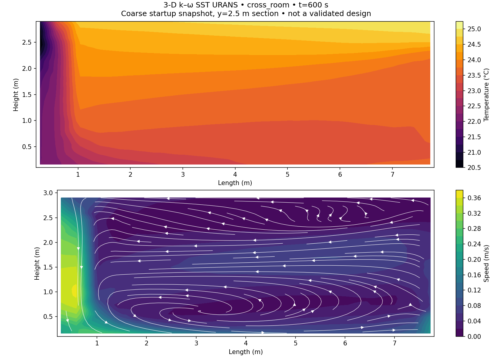
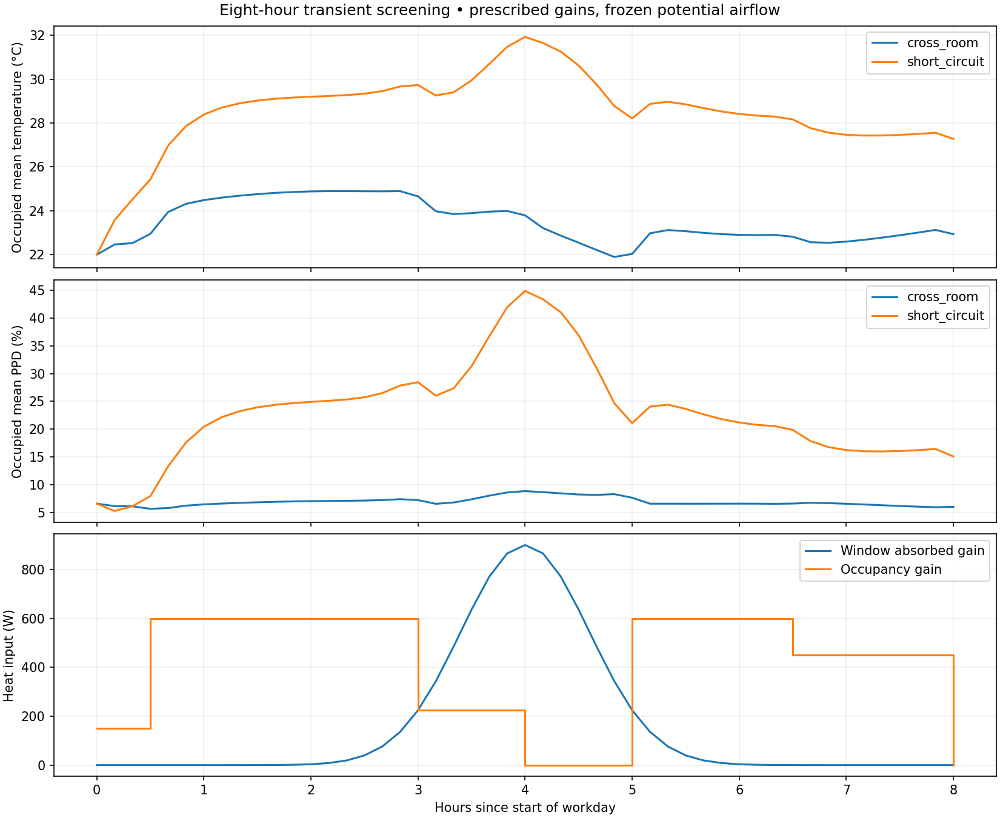

# Indoor Air Lab
### 3-D OpenFOAM URANS · transient heat transport · interactive comfort maps

An engineering portfolio by **Sibly Noman** exploring room ventilation through three reproducible layers.

**Live public lab:** https://noman-indoor-air-lab.sibly-noman2003.chatgpt.site/lab.html

| Layer | Implementation | Executed status |
|---|---|---|
| Rapid screening | Python finite-volume potential airflow, temperature and air age | Both layouts run; conservation, comfort and mesh checks |
| Dynamic workday | Backward-Euler heat transport, scheduled occupants/supply/window heat gain | Eight-hour histories run for both layouts; energy/timestep tests |
| 3-D RANS | OpenCFD v1912, buoyantBoussinesqPimpleFoam, k–ω SST | Both layouts run to 600 s; mesh checks, actual VTK fields and full logs |
| Interactive tools | Streamlit + Plotly app; public browser finite-volume calculator | Streamlit AppTest passes; browser/Python full-field parity tests pass |

**Interpretation:** Python/browser results are simplified potential-flow screening. 3-D results are **coarse startup URANS snapshots**, not steady, time-averaged, mesh-independent or experimentally validated design predictions. The live sliders recompute screening equations, not RANS. No ISO/ASHRAE compliance claim is made.



## Run the interactive Python app

Python 3.11+; install the dashboard dependencies:

```bash
pip install -r requirements-dashboard.txt
streamlit run streamlit_app.py
```

Adjust room dimensions, ACH, supply/wall temperature, return arrangement, steady/workday mode, solar gain and workday hour. Plotly contours show temperature, PMV, PPD and speed. Export CSV histories and JSON configuration. A Dockerfile is included for compatible Python hosting. Streamlit is **not** hosted on the Sites URL; the public Site uses the tested browser solver and needs no Python server.

## Reproduce the numerical studies

```bash
pip install -r requirements.txt
python -m unittest discover -s tests -v
python -m iaq
python -m iaq.transient
python -m iaq --nx 120 --nz 45 --output results/fine
```

Install `requirements-dashboard.txt` to run the Streamlit test, and have Node installed for browser/Python parity tests; optional tests otherwise report skips. GitHub Actions installs both and runs the full suite.

For OpenFOAM, follow [the executed case guide](openfoam/README.md). Both initial-condition case directories are included; raw3-D output is in `results/rans`. A manually triggered `OpenFOAM 3-D URANS` workflow reruns the cases on Ubuntu 24.04.

## Computed findings

### 2-D steady screening

Room 8×5×3m, Q = 0.12 m³/s, ACH 3.6, supply 19°C, 600 W sensible load, 26°C wall/MRT assumption.

| Metric | Cross-room | Nearby return |
|---|---:|---:|
| Occupied mean temperature |23.36°C|27.69°C|
| Occupied mean air age |665s|3159s|
| Mean PMV |−0.031|+0.713|
| Mean local PPD |5.83%|16.98%|

Both layouts predict occupied speeds below 0.05 m/s in the potential-flow model. The screening result motivates further distribution studies; it is not a draft assessment.

### Executed 3-D URANS at t=600s

| Metric | Cross-room | Nearby return |
|---|---:|---:|
| Cells |3840|3840|
| Occupied mean temperature |23.46°C|24.16°C|
| Occupied mean speed |0.0598m/s|0.0529m/s|
| Mean PMV |−0.034|+0.102|
| Mean local PPD |5.36%|5.34%|
| Final relative net boundary flux |8.3e−9|8.3e−9|

The 3-D cases have finite 1 m-wide supply/return patches, no-slip walls, buoyancy and SST turbulence. Their fixed 26°C walls differ from the screening model's Robin heat transfer, and their vent areas differ from the full-depth screening slots. Do not treat the numbers as a controlled solver-fidelity comparison. The 600 s snapshot is shorter than one nominal 1000 s air-residence time; it does not establish a final comfort ranking.

The initial steady SIMPLE attempt did not converge. The successful cases use transient PIMPLE. Runtime function objects fail in the Ubuntu v1912 package's SHA1 stream; they were disabled for the verified runs. yPlus postprocessing also failed, so no wall-resolution qualification is claimed. Refinement, wall-treatment checks, longer runs and experimental validation remain necessary for wall-jet design claims.

### Eight-hour workday



Defaults: initial 22°C, 150 W equipment, 75 W/person with scheduled occupancy, 900 W midday absorbed window heat spike, supply variation ±1.5°C. The solar input is an assumed deposited heat source, not a radiation/glazing simulation. Airflow is frozen. See [transient methodology](docs/transient-and-dashboard.md).

## What is verified

- Python cell volume-flux conservation, uniform scalar preservation and a Fanger reference point.
- Transient energy balance, uniform-state preservation and 120/60 s timestep sensitivity.
- Full-field browser/Python steady T/age parity and final 8 h temperature parity.
- Streamlit input changes and workday mode using AppTest.
- OpenFOAM mesh checks, finite fields, positive turbulence variables and recorded final inlet/outlet flow balance. Small linear residuals are not physical validation.

## Repository map

| Path | Purpose |
|---|---|
|`iaq/`|Python steady/transient numerical models and PMV/PPD|
|`streamlit_app.py`|Streamlit app with Plotly contours|
|`web/`|Public landing page, interactive worker solver and contour renderer|
|`openfoam/`|3-D case generator, two URANS cases, run/export guide|
|`results/rans/`|Actual 3-D VTK/NPZ fields, section plots, reports and compressed solver logs|
|`results/transient/`|Eight-hour raw fields, histories and load plots|
|`scripts/build_site.py`|Rebuild static public Site assets|
|`docs/`|Equations, boundaries, assumptions and deployment distinctions|

## Portfolio description

Built a reproducible indoor ventilation study combining a Python finite-volume screening solver, eight-hour transient heat transport and executed 3-D buoyant OpenFOAM k–ω SST URANS cases. Developed a Streamlit/Plotly dashboard and public browser calculator with PMV/PPD contours, verified cross-language field agreement and documented numerical/physical limits.

## References and license

[Methodology and primary references](docs/methodology.md) · [OpenFOAM run specification](openfoam/README.md) · [Transient/dashboard guide](docs/transient-and-dashboard.md). MIT license for project code; OpenFOAM is separate GPL software and is not redistributed here.
