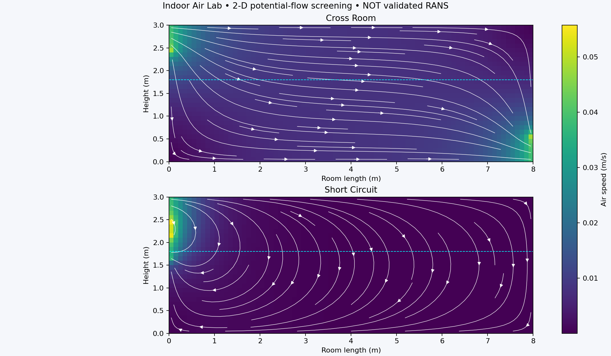
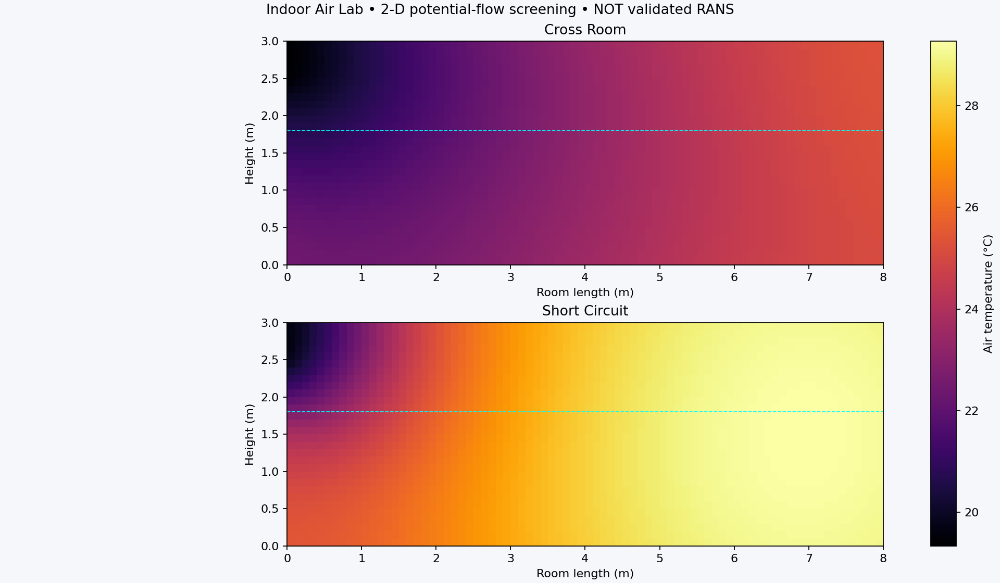
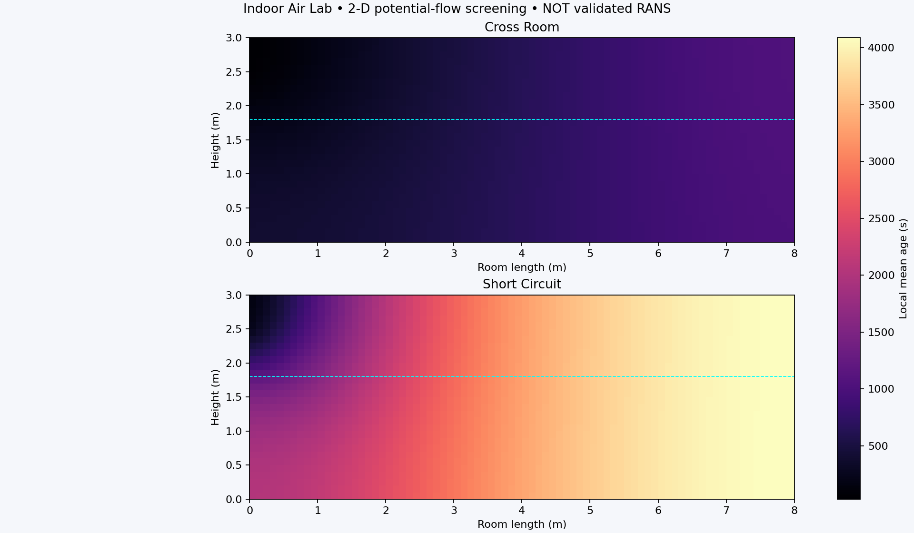
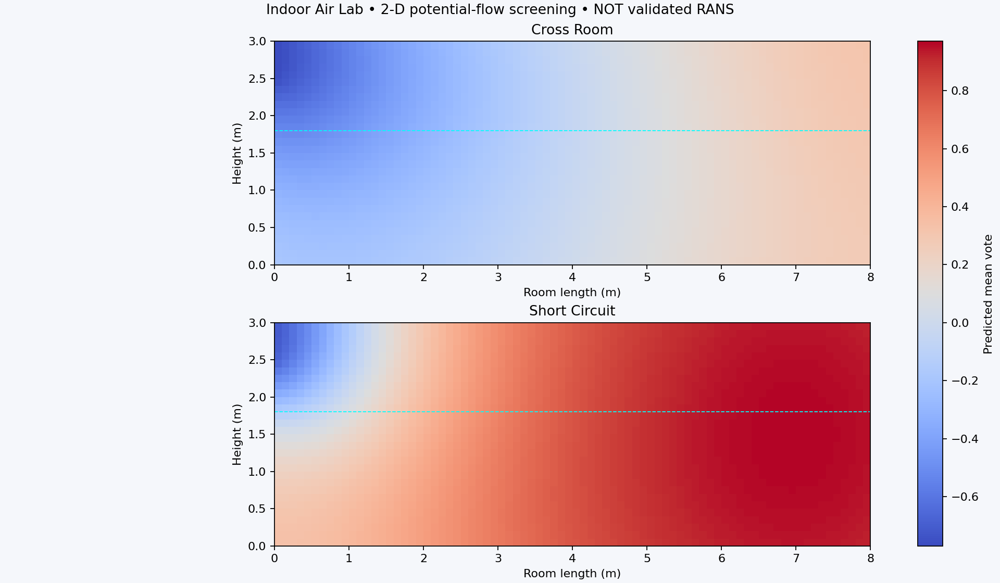

# Indoor Air Lab
### Indoor airflow • heat transport • local air age • PMV / PPD

A reproducible engineering portfolio project by **Sibly Noman** comparing two supply/return arrangements in an 8 × 5 × 3 m conditioned room.

**Status:** executed Python finite-volume screening study. **Not** a completed OpenFOAM/ANSYS simulation or a validated turbulent HVAC model. This project uses an irrotational, isothermal-momentum approximation with transported temperature; thermal buoyancy is omitted. See [methodology](docs/methodology.md) before interpreting the plots.



## Reproduce

Requires Python 3.11+.

```bash
python -m venv .venv
# Linux/macOS
source .venv/bin/activate
# Windows PowerShell: .venv\Scripts\Activate.ps1
pip install -r requirements.txt
python -m unittest discover -s tests -v
python -m iaq
# Mesh sensitivity
python -m iaq --nx 120 --nz 45 --output results/fine
```

The run generates common-scale PNG comparisons, raw compressed NumPy fields, CSV metrics and a JSON summary. GitHub Actions reruns tests and analysis and retains output artifacts. `python -m iaq --help` lists options; use `iaq.model.Config` for physical inputs.

## Computed comparison

| Metric | Cross-room return | Nearby return |
|---|---:|---:|
| ACH | 3.6 | 3.6 |
| Occupied mean temperature | 23.36°C | 27.69°C |
| Occupied mean air age | 665 s | 3159 s |
| Occupied air change index | 1.503 | 0.317 |
| Whole-room air exchange efficiency | 0.774 | 0.164 |
| Occupied mean PMV | −0.031 | +0.713 |
| Occupied mean local PPD | 5.83% | 16.98% |
| Occupied fraction below 0.05 m/s | 100% | 100% |

Cross-room distribution is the better candidate **within this approximation**. Both cases have low occupied-zone velocities. The model cannot predict real diffuser jets, recirculation or draft risk, so these are screening findings rather than a final design recommendation.





## Verification

- Cell volume-flux imbalance below 6×10⁻¹⁴ m³/s in the included runs.
- Uniform scalar preservation, finite positive age and a PMV reference point checked automatically.
- Fine-mesh occupied mean temperature changes below 0.004°C; air-age changes below 0.2%. See [mesh comparison](results/mesh_study.json).
- No experimental validation or claim of standards compliance.

## Files

- `iaq/model.py`: sparse finite-volume potential-flow and scalar solver.
- `iaq/comfort.py`: Fanger PMV/PPD calculation.
- `iaq/__main__.py`: CLI and common-scale plots.
- `geometry/`: CAD-compatible OBJ room shell and labeled vent schematic.
- `results/`: actual executed outputs and mesh comparison.
- `docs/methodology.md`: equations, boundary conditions, assumptions and design interpretation.
- `docs/openfoam-roadmap.md`: explicit 3-D RANS specification for extending this screening model.
- `.github/workflows/verify.yml`: reproducibility workflow.

## Portfolio description

Developed a Python finite-volume indoor ventilation screening tool comparing diffuser/return layouts using conservative airflow, temperature and air-age transport, plus Fanger PMV/PPD maps. Verified mass conservation, scalar preservation and mesh sensitivity; documented the limits of potential-flow assumptions and the requirements for 3-D buoyant CFD validation.

## License
MIT. Educational analysis; not a certified building design tool.
